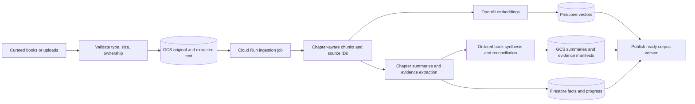
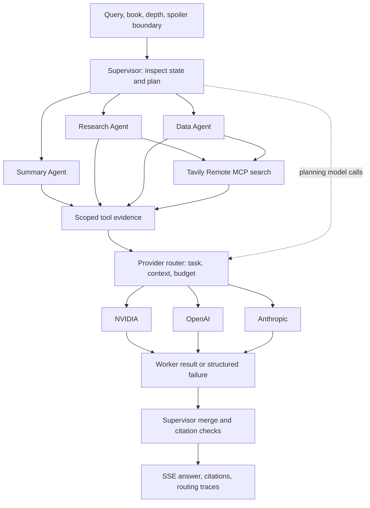
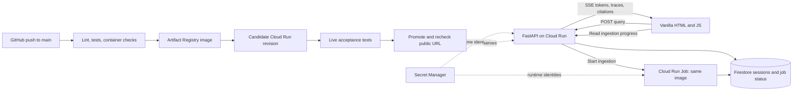
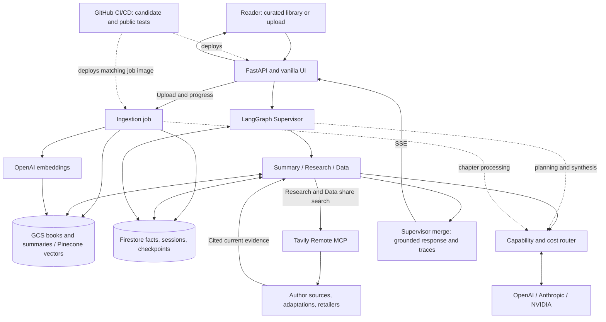

# My Book Companion Architecture

I propose this design for review; I do not claim it is implemented or benchmarked. I keep implementation status and open decisions in [my requirements](requirements.md).

## My topology and scope

- I use **LangGraph Supervisor orchestration**: one coordinator, three specialist agents, explicit state, bounded delegation.
- I select the rubric's Supervisor option; I avoid extra team supervisors for three workers. I use hierarchical *book summarization*, which is separate from agent topology.
- I support fiction/nonfiction, a curated library, uploads, adjustable summary depth, character/event analysis, author research, adaptations, and purchase links.
- I use one Python codebase/container image for my FastAPI web service and a separately executed ingestion job.

| My component | My responsibility and exclusive tools |
| --- | --- |
| Supervisor | I classify intent, choose workers, enforce budgets, merge results, and handle failures; I do not count it as a specialist. |
| Summary Agent | I read ordered chapter summaries/passages and synthesize cited overviews or deep dives; my exclusive tool assembles chapter evidence. |
| Research Agent | I query book chunks through LangChain LCEL RAG and research authors/adaptations; my exclusive tool performs semantic retrieval. |
| Data Agent | I query structured Firestore JSON records for characters, events, concepts, and editions; my exclusive tools query these records and normalize edition/purchase results. |

I give each specialist its own prompt and tool permissions. Research and Data share the **same Tavily Remote MCP search tool**: Research searches adaptations/author context; Data searches editions and hardcover purchase links. I record both invocations in traces.

## My LLM routing

I route by task, requested depth, context size, measured cost/quality, and availability—not by a permanently fixed provider per agent.

| My task class | My proposed provider preference | My selection rationale |
| --- | --- | --- |
| Short grounded lookup, chapter extraction | NVIDIA Nemotron | I test suitability for bounded tasks and use measured cost to establish its budget role. |
| Structured planning, tool decisions, mixed synthesis | OpenAI | I prioritize validated structured-output and tool-use performance. |
| Detailed cross-chapter or interpretive synthesis | Anthropic | I prioritize measured long-context quality for demanding requests. |

- I exercise at least two providers on normal user requests; all three are candidates for my comparison.
- I keep exact model IDs, provider benchmarks, and spending limits in configuration/requirements; these preferences are hypotheses, not measured rankings.
- I allow one logged fallback only when it meets the same capability/context constraints. I never silently downgrade a deep analysis.
- I use OpenAI `text-embedding-3-small` as my proposed embedding configuration; embeddings do not count as a generation provider.
- I keep provider calls behind one adapter; providers receive scoped evidence and do not communicate directly with one another.

## 1. My ingestion and knowledge flow

- I accept text-based PDF, EPUB, and TXT as my proposed upload scope; I report unsupported/scanned inputs explicitly.
- I preserve `book_id`, edition, chapter, chunk ID, and page/location; I use location anchors when pages do not exist.
- I start with chapter-bounded chunks around 800 tokens and 120-token overlap, then tune against evaluation.
- I use bounded chapter processing plus ordered reconciliation to retain chronology, recurring characters, and nonfiction arguments.
- I key ingestion by owner, content hash, and pipeline version; retries reuse completed work. I publish readiness only after all stores pass consistency checks.
- I use Pinecone for mutable uploaded-book vectors, GCS for large artifacts, and Firestore for small structured records/progress. I keep complete book text out of graph state.

I use a Cloud Run Job for long ingestion rather than tying it to the chat request lifetime. [Google Cloud Jobs](https://docs.cloud.google.com/run/docs/create-jobs)

## 2. My per-turn orchestration and provider flow

I delegate only relevant workers and parallelize independent research/data lookups. Workers return evidence to the supervisor; I bound tool rounds and retries to prevent loops. LangGraph supports routing, parallelization, and orchestrator/worker patterns. [LangGraph workflows](https://docs.langchain.com/oss/python/langgraph/workflows-agents)

| My graph-state group | My fields |
| --- | --- |
| Identity and scope | `owner_id`, `session_id`, `turn_id`, `book_id`, `corpus_version` |
| Request | `query`, `intent`, `depth`, `spoiler_limit`, `book_type` |
| Execution | `plan`, `active_workers`, `provider_routes`, `budget`, `attempts` |
| Evidence and result | `chunk_refs`, `worker_results`, `citations`, `errors`, `status` |

- I start focused Q&A at `top_k=6`, filter by authorized book/version/spoiler scope, and retrieve adjacent passages when needed.
- I build whole-book summaries from the chapter manifest, not a few top-k matches; I expose character/event details through structured evidence.
- I use this augmentation contract: “I answer from supplied evidence; I attach source IDs to factual claims, separate interpretation/web context, and state when evidence is missing.”
- I persist conversation/graph checkpoints through a Firestore-backed adapter; I store large evidence in GCS and keep references in state. I treat checkpoint persistence as distinct from reusable book knowledge. [LangGraph persistence](https://docs.langchain.com/oss/python/langgraph/persistence)

## 3. My runtime, deployment, and user experience

- I show a usable curated library immediately; uploads show progress and become selectable after indexing completes.
- I stream progress before synthesis and answer tokens during generation; I distinguish progress latency from actual time to first answer token.
- I expose Overview, Chapters, Characters/Concepts, Events/Arguments, Author, Adaptations, and Buy views according to book content.
- I provide expandable citations, separate web-source labels, spoiler limits, cancellation, and clear partial-failure messages.
- I bind server-side ownership to a signed session; I do not treat a caller-supplied `session_id` as authorization. I enforce ownership on retrieval, artifacts, and citation endpoints.
- I isolate private vectors by owner namespace and filter book/version within it; curated content has a separate namespace. [Pinecone multitenancy](https://docs.pinecone.io/guides/index-data/implement-multitenancy)
- I treat uploaded text and web results as untrusted evidence, never as permission to change tools or expose secrets.

## 4. My complete system

## My architecture scrutiny

| My concern | My design response | My remaining tradeoff |
| --- | --- | --- |
| Summary omissions | I retain every chapter in a coverage manifest and reconcile entities/events. | I measure major-point coverage; compression cannot retain every detail. |
| Too many model calls | I use one supervisor, targeted delegation, cached chapter artifacts, and bounded parallelism. | I measure routing overhead against answer quality. |
| Upload delays and duplicate work | I separate ingestion, persist progress, and use idempotent versioned writes. | I accept background-job setup and a wait before full-book access. |
| Storage complexity | I give vectors, large files, and mutable state distinct stores. | I accept three services for upload durability; I publish versions atomically through a readiness record. |
| Faults during streaming | I preserve completed evidence, report worker failures, and check citation references before emitting answer sections. | I cannot retract already displayed text; semantic grounding still needs evaluation. |
| Spoilers and misleading web results | I filter evidence before generation and label external facts, dates, and editions. | I limit or disable web context in spoiler-sensitive requests; web search can be incomplete. |
| Cache leakage or stale prices | I scope caches by owner/book/version/depth/spoiler policy and timestamp web results. | I avoid treating cached retailer availability as a guarantee. |
| Provider or deployment failure | I use bounded fallback, persistent checkpoints, and candidate/live release gates. | I prove recovery and latency through tests; the diagram is not evidence of reliability. |

## My review standard

I assess this design with all four required RAGAS metrics, chapter/event coverage, provider comparisons, cold/warm TTFT, total latency, per-query cost, upload isolation, and actual two-agent MCP sharing. I use those measurements—not architectural complexity—to justify optimizations.
