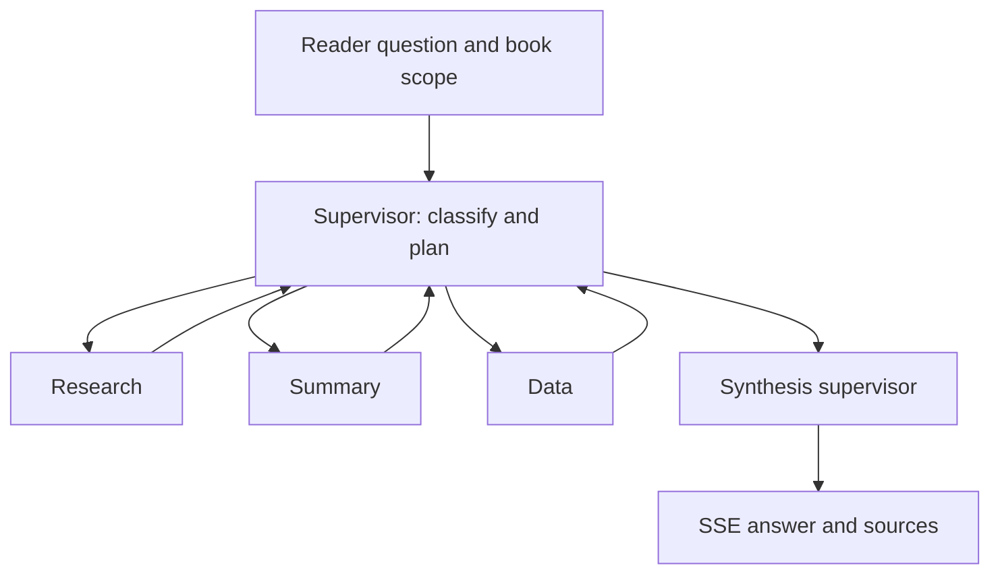
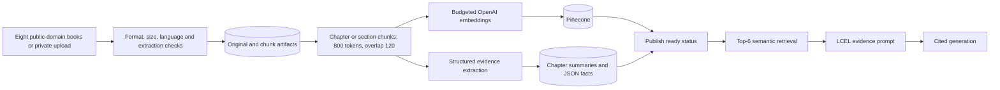
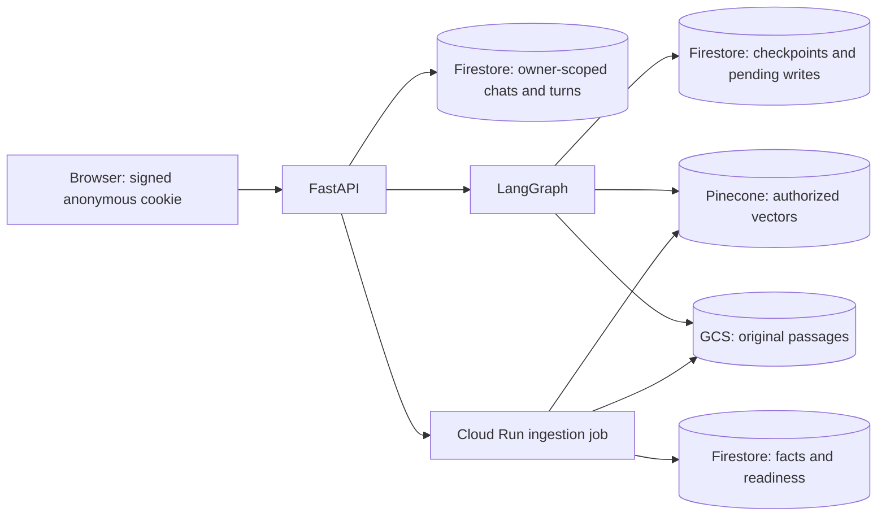
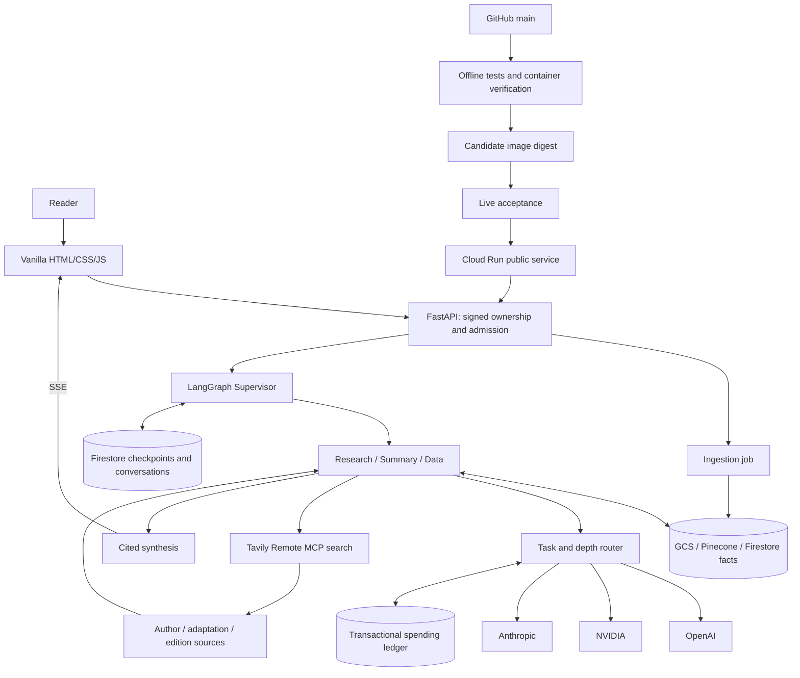

# Book Companion Architecture

I chose one LangGraph supervisor and three specialists so that book retrieval, summarization, and structured analysis have clear responsibilities. I serve the interface through FastAPI and stream answers with their sources and activity traces. My verification record is in [requirements.md](../agent_docs/requirements.md).

## Agent topology

| Node | Prompt and tools |
| --- | --- |
| Supervisor | I classify the request into relevant workers through structured model output and inspect `plan`/`completed` state. |
| Research | I answer from a LangChain LCEL semantic retriever and original passages; I use Tavily for author/adaptation research. |
| Summary | I read ordered chapter evidence maps, reduce large collections, preserve chronology, and retain original chunk references. |
| Data | I query structured JSON records for characters, concepts, and events; I use Tavily for editions and purchase sources. |
| Synthesis | I combine successful worker results, retain citations, disclose failed workers, and stream the final answer. |

I give each specialist a separate system prompt and different tools. My supervisor does not count toward the three-specialist requirement. Each worker returns to the supervisor; a failed worker records a structured failure, and successful workers can still contribute. If every selected worker fails, I return an incomplete response.

I generate the worker plan once, then make each transition from the current state:

1. I read `plan` and `completed` to choose the next unfinished worker.
2. I trace that hop with its reason, available results, and sanitized errors.
3. I return to the supervisor after each worker and synthesize after the selected workers finish.

I trace Summary's question, book, spoiler boundary, maps, and chunk IDs before generation. An off-topic request gets an empty plan and a book-focused redirect, without a worker or synthesis-model call.

## Provider routing

| Task | Normal provider/model | Rationale |
| --- | --- | --- |
| Planning and evidence extraction | OpenAI `gpt-6-luna` | I use low-cost, schema-constrained output for bounded structured work. |
| Brief/detailed evidence-based responses | NVIDIA `nvidia/nemotron-3-ultra-550b-a55b` | I use my confirmed student access for ordinary generation. |
| Deep cross-section synthesis | Anthropic `claude-sonnet-5` | I use the selected Sonnet model for detailed interpretation. |
| Embeddings | OpenAI `text-embedding-3-small`, 1,536 dimensions | I use one compatible embedding space for indexing and queries; this does not count as a generation provider. |

I route by task and requested depth, exposing the provider, model, task, and reason in `llm_route` events.

- I choose another configured provider if the preferred one is unavailable in configuration.
- If a call fails before publishing text, I try at most one alternative, with a visible reason and a separate budget reservation. I discard any unpublished incomplete draft first.
- Once final-answer text starts, I do not switch providers. I report provider-side output truncation as an incomplete response.

I reserve a conservative cost estimate before each OpenAI/Anthropic call. I settle actual token costs when available and retain the reservation when billing is uncertain. My separate limits are $5 OpenAI and $2.50 Anthropic. I record embedding costs as conservative byte-token estimates. My cloud ledger is shared across workers and instances.

## Ingestion and RAG

- I curate four fiction and four nonfiction books through the official Project Gutenberg mirror. I preserve original files and source URLs; my manifest is `corpus/manifest.json`.
- I accept English PDF/EPUB/TXT, at most 25 MB. I cap PDFs at 500 physical pages, EPUB/TXT at 125,000 words, and extracted input at 250,000 tokens.
- I reject encrypted or unreadable input, unsafe EPUB paths, and excessive expanded EPUB size. I use deterministic language detection before paid processing.
- I assign stable book/section/token-offset chunk identifiers and preserve PDF page locations. A text without recognized headings is labelled `Full text` rather than given invented chapter boundaries.
- I exclude a repeated heading-only contents list from narrative chapter numbering. I keep the original document separately.
- I embed and store chunks in a namespace belonging to the owner, or `public` for my curated library. I filter semantic retrieval by authorized book and spoiler boundary.
- I use `RunnableLambda(retrieve) | PromptTemplate | RunnableLambda(generate)` for Research's retrieve–augment–generate chain.
- I augment with `[chunk_id] original passage` blocks and require original source IDs in factual answers. I treat evidence as data, never as instructions.
- I map every chunk into a bounded structured extraction group. Summary reads all evidence maps within scope, rather than treating top-k retrieval as a whole-book summary.
- I query stored character/event/concept JSON records in Data. I order records numerically by section and token offset.
- I preserve validated extracted JSON and record the size of any discarded model continuation. I never discard original book text to repair model output.

## Memory and runtime

| State group | Actual fields |
| --- | --- |
| Identity | `owner_id`, `session_id`, `book_id` |
| Request | `query`, `depth`, `spoiler_limit`, bounded `history` |
| Execution | `plan`, `plan_reason`, `completed`, `initialized` |
| Results | `results`, `errors`, `citations`, `answer` |

I keep conversation state separate from the book index:

- **Ownership:** I verify a signed HttpOnly cookie; a supplied chat ID is not authorization. I isolate chats and exclude incomplete or out-of-scope earlier answers from model history.
- **Persistence:** I reserve each chat/turn atomically, reject duplicates and overlapping turns, and save completion before reporting success. I store LangGraph checkpoints and intermediate writes through the same storage adapter.
- **Storage:** I use SQLite locally, Firestore for cloud conversations/checkpoints/facts, GCS for originals and chunks, and Pinecone for book vectors.
- **Ingestion:** I use a separate Cloud Run Job, or a tracked asynchronous task locally, so uploads do not hold a chat request open.

I handle retries and interruptions explicitly:

- I reserve an ingestion lease, reject competing jobs, and publish readiness only after all vectors and maps succeed. Retrying the same pipeline reuses completed maps; only the private owner can retry a failed or expired job.
- I bound the ingestion job to one hour and 2 GiB. I reject malformed EPUB metadata and XML entities, but do not claim every hostile PDF is resource-safe.
- I pin the curated snapshot to pipeline 2. Changing chunking requires an explicit corpus migration.
- I set a 270-second application deadline inside Cloud Run's 300-second timeout, leaving time to save failure status. I poll cancellation even while a provider is silent and close the pending stream on Stop.
- I mark an expired turn lease interrupted after process loss. Unpublished partial output can be lost; completed answers remain durable.
- I enforce hourly admission limits separately from paid-budget reservations. My browser cookie lasts 30 days; clearing it removes access but does not immediately erase server-side data.

## Complete workflow

I expose the same `tavily_search` MCP tool to Research and Data through Streamable HTTP. Research searches author/adaptation sources; Data searches editions and retailers. I record distinct agent/query contexts in tool traces. I suppress Research web expansion under a chapter spoiler boundary; I do not present retailer availability as guaranteed.

I render model text safely and link original source passages. I parse arbitrary UTF-8/network frame boundaries, reject malformed or incomplete streams, disable overlapping submission, and preserve per-turn traces. My UI offers overview, chapter, character/concept, event/argument, author, adaptation, and purchase-question entry points.

My container uses a multistage Python 3.13-slim build, `/app/.venv`, a non-root user, and Cloud Run's `PORT`. My workflow uses repository/main-scoped OIDC, Secret Manager, a tested image passed between jobs, candidate checks, promotion, public checks, and traffic rollback after a failed post-promotion check.

## Practical limits

I cannot preserve every detail in a compressed summary. I keep original source passages inspectable and distinguish interpretation from evidence. Language detection is probabilistic, PDF pages are not necessarily chapters, and files without explicit headings provide coarse spoiler boundaries. I report failed processing rather than publishing a partially indexed book as ready. I explain which checks used fixtures and which reached real services in my evaluation report.
